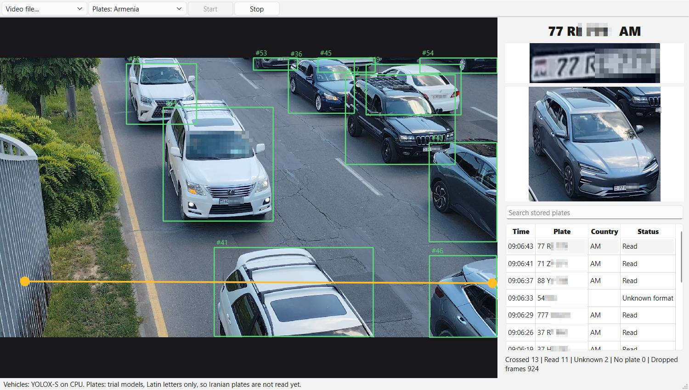

# Vehicle Plate Recognition

A cross platform (Windows, Linux) C++20 and Qt 6 library that tracks vehicles in video and, when a
vehicle crosses an adjustable line, reports its plate number with a photo of the vehicle.
Target plates: standard private plates of Armenia and Iran.



*The test tool on a phone video from Yerevan. The second half of every plate number, and the people in one car, are pixelated for privacy.*

**Status: early development.** The architecture, tracking, line crossing, plate voting, storage and test UI work and are tested.
Vehicles are detected with a pretrained YOLOX-S model, and plates are found and read with two published **trial** models, all on the CPU.
On seven phone videos from Yerevan, 229 vehicles crossed the line and 191 plates were read in a private Armenian format.
**Accuracy has not been measured yet**, because no labelled test set exists. The trial reader knows Latin letters only, so Iranian
plates cannot be read yet, and the trial models are not cleared for commercial use (see Third party licences).

## Build

Requires CMake 3.21+, a C++20 compiler and Qt 6.5+ with Multimedia. Real detection also needs ONNX Runtime, the YOLOX-S vehicle model and two trial plate models:
`scripts/fetch-dependencies.sh` downloads about 135 MB into `third_party/` and `models/` and checks the checksums. Run it in bash
(Git Bash on Windows) before configuring. Without them the project still builds, and real video shows no detections.

```bash
bash scripts/fetch-dependencies.sh
```

```bash
cmake -S . -B build -DCMAKE_BUILD_TYPE=Release -DCMAKE_PREFIX_PATH=<path to Qt kit>
cmake --build build --parallel
ctest --test-dir build --output-on-failure
```

Run `build/apps/test-ui/vpr-test-ui`, choose **Synthetic demo** or **Video file...** and press Start. Drag either end of the yellow line to move it.
When a vehicle crosses the line, its plate text, plate photo and vehicle photo show at once and a row is added to the table.
The table lists the passages of the current run; type in the search box to find stored passages of earlier runs.
Options: `--video <file>` starts a file directly, `--line ax,ay,bx,by` places the line (0 to 1 of the picture), `--data-dir <folder>`
keeps passages and photos there, and `--quit-at-end` exits when the video ends, after saving `--snapshot <file>` if given.

Hand checked vehicle photos named after their plate, for example `data/plate-samples/12AB345.jpg`, are read by the `real_plates` test.
They are personal data and stay out of git.

## Layout

| Folder | Layer | May depend on |
|---|---|---|
| `src/domain` | Types, ports, plate formats | Standard library only |
| `src/application` | Use case: `PassagePipeline`, line crossing, plate voting | Domain |
| `src/infrastructure/tracking` | ByteTrack style tracker | Domain |
| `src/infrastructure/onnx` | Vehicle detector, plate detector and plate reader on ONNX Runtime | Domain, ONNX Runtime |
| `src/infrastructure/qt` | Frame sources, JSON and photo output, SQLite, worker thread | Application, Qt |
| `src/simulation` | Synthetic scene for tests and demo | Domain |
| `apps/test-ui` | Test tool and composition root | Everything |

`cmake/CheckArchitecture.cmake` runs as a test and fails the build when an include points the wrong way.

## Extending

- **New camera:** implement `IFrameSource`. See `src/infrastructure/qt/media_frame_sources.h`.
- **New country:** add a `PatternPlateFormat` definition and train the reader on its characters.
- **New model:** implement `IVehicleDetector`, `IPlateDetector` or `IPlateReader`.

## Documents

Project documents are written in Markdown in `docs/md/en` and `docs/md/fa` (Persian). Running `docs/build-docs.ps1`
turns them into the Word files in `docs/en` and `docs/fa` in about a second, without Microsoft Word.

## Data and privacy

Plate numbers and road footage are personal data. They are ignored by git and must not be committed.
The test tool deletes stored passages and their photos after 30 days.

## Third party licences

| Component | Licence | How it is used |
|---|---|---|
| Qt 6 | LGPL 3 | Linked dynamically |
| ONNX Runtime 1.31.1 | MIT | Downloaded, not in this repository |
| YOLOX and its YOLOX-S model | Apache-2.0 | Downloaded, not in this repository |
| Plate detector `yolo-v9-t-640-license-plates-end2end`, from ankandrew/open-image-models | Project code MIT. The model comes from YOLOv9, whose original repository is GPL-3.0 | Trial only, downloaded, not in this repository |
| Plate reader `cct_s_v2_global`, from ankandrew/fast-plate-ocr | Project code MIT. A third party model card states the training data is CC-BY-NC-ND-4.0, not confirmed at the source | Trial only, downloaded, not in this repository |

The two plate models are for trials. Their licences have not been settled for commercial use, so they must be replaced by
our own models before any customer pilot. The code does not depend on them: any model behind `IPlateDetector` or `IPlateReader` works.
